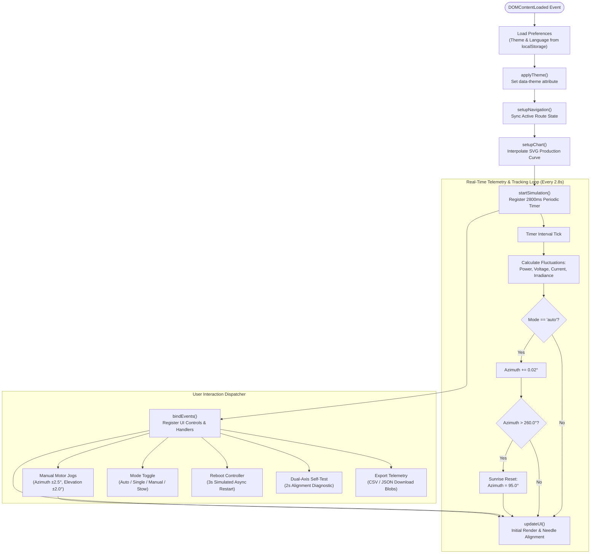

# HelioTrack Algorithm Flowchart & Specification

This document provides a comprehensive breakdown of the core algorithms running in the **HelioTrack** dual-axis solar tracker application ([app.js](file:///home/dimas/solar-panel-tracker/app.js)).

---

## 1. High-Level System Architecture



---

## 2. Core Algorithm Details

### A. Lifecycle & Bootstrapping (`SolarApp.init`)
1. **Preference Hydration**: Reads `heliotrack_theme` (defaults to `'dark'`) and `heliotrack_lang` (defaults to `'en'`) from `localStorage`.
2. **Navigation State Detection**: Parses `window.location.pathname` or `hash` to toggle `.active` class between `#nav-home` and `#nav-settings`.
3. **Subsystem Initializers**:
   - `setupChart()` prepares SVG geometry and hover tooltips.
   - `startSimulation()` sets up recurring 2.8s polling timer.
   - `bindEvents()` registers click/change event listeners.
   - `updateUI()` triggers first visual pass to synchronize needle compasses with internal angles.

---

### B. Telemetry Simulation & Solar Tracking Loop (`startSimulation`)
Runs every **2800 ms**:

#### 1. Mathematical Fluctuations
- **Power ($P$)**:
  $$\Delta P = (\text{random}() - 0.48) \times 0.06$$
  $$P_{t+1} = \text{clamp}(3.2, P_t + \Delta P, 5.6) \quad [\text{kW}]$$
- **Voltage ($V$)**:
  $$\Delta V = (\text{random}() - 0.50) \times 0.80$$
  $$V_{t+1} = \text{clamp}(370, V_t + \Delta V, 410) \quad [\text{V}]$$
- **Current ($I$)**:
  $$I_{t+1} = \frac{P_{t+1} \times 1000}{V_{t+1}} \quad [\text{A}]$$
- **Solar Irradiance ($Irr$)**:
  $$\Delta Irr = (\text{random}() - 0.48) \times 4$$
  $$Irr_{t+1} = \text{round}(\text{clamp}(750, Irr_t + \Delta Irr, 980)) \quad [\text{W/m}^2]$$

#### 2. Astronomical Tracking Angle Progression
- If `mode === 'auto'`:
  $$\text{Azimuth}_{t+1} = \text{round}(\text{Azimuth}_t + 0.02^\circ, 1)$$
  - **Sunset Reset Check**: If $\text{Azimuth} > 260.0^\circ$, resets back to morning sunrise heading $95.0^\circ$.
- If `mode !== 'auto'` (`single`, `manual`, `stow`):
  - Angle maintains its last physical position.

#### 3. DOM Needle Synchronization
- Azimuth Compass Dial:
  ```javascript
  elNeedle.style.transform = `rotate(${this.state.azimuth}deg)`;
  ```
- Elevation Needle Dial:
  ```javascript
  elElevationNeedle.style.transform = `rotate(${this.state.elevation}deg)`;
  ```

---

### C. SVG Production Curve Interpolation (`setupChart`)

The app plots a smooth 24-hour generation curve using 13 hourly readings ($N = 13$, 06:00 to 18:00):

1. **Coordinate Normalization**:
   - Width $W = 360$, Height $H = 140$, $\text{pad}_X = 15$, $\text{pad}_Y = 20$, $\text{maxKw} = 6.0$.
   $$X(i) = \text{pad}_X + \frac{i}{N - 1} \times (W - 2\text{pad}_X)$$
   $$Y(kW) = H - \text{pad}_Y - \frac{kW}{\text{maxKw}} \times (H - 2\text{pad}_Y)$$

2. **Cubic Bézier Interpolation**:
   Between point $i-1$ and $i$, intermediate horizontal control points are computed:
   $$cpX_1 = X_{i-1} + \frac{X_i - X_{i-1}}{2}, \quad cpY_1 = Y_{i-1}$$
   $$cpX_2 = cpX_1, \quad cpY_2 = Y_i$$
   Path segment appended:
   ```text
   C cpX1,cpY1 cpX2,cpY2 Xi,Yi
   ```

3. **Interactive Data Markers**:
   Generates `<circle>` nodes with hover event listeners:
   - `mouseenter`: radius expands from $3.5 \to 6.0\text{px}$, emits interactive Toast alert.
   - `mouseleave`: restores radius to $3.5\text{px}$.

---

### D. User Controls & Hardware Event Handlers (`bindEvents`)

| Control | Element ID / Selector | Action & State Mutation | Feedback |
| :--- | :--- | :--- | :--- |
| **Jog West / Left** | `#jog-left` | $\text{Azimuth} = \max(0, \text{Azimuth} - 2.5^\circ)$ | `updateUI()` + Toast |
| **Jog East / Right** | `#jog-right` | $\text{Azimuth} = \min(360, \text{Azimuth} + 2.5^\circ)$ | `updateUI()` + Toast |
| **Jog Tilt Up** | `#jog-up` | $\text{Elevation} = \min(90, \text{Elevation} + 2.0^\circ)$ | `updateUI()` + Toast |
| **Jog Tilt Down** | `#jog-down` | $\text{Elevation} = \max(0, \text{Elevation} - 2.0^\circ)$ | `updateUI()` + Toast |
| **Tracking Mode** | `[data-track-mode]` | Changes `state.mode` (`auto`, `single`, `stow`) | Active button class + Toast |
| **ESP32 Reboot** | `#btn-reboot-device` | Disables button $\to$ 3000ms delay $\to$ Re-enables | Simulated online toast |
| **Self-Test** | `#btn-self-test` | Emits test start toast $\to$ 2000ms delay | "100% accuracy" toast |
| **Export CSV** | `#btn-export-csv` | Compiles telemetry matrix $\to$ `data:text/csv` URI blob | Auto-downloads `.csv` |
| **Export JSON** | `#btn-export-json` | Serializes state & health tree $\to$ `data:text/json` | Auto-downloads `.json` |

---

## 3. Related Files

- [flowchart.png](file:///home/dimas/solar-panel-tracker/flowchart.png): Rendered high-resolution graphical diagram.
- [flowchart.svg](file:///home/dimas/solar-panel-tracker/flowchart.svg): Vector graphic version of the flowchart.
- [flowchart.txt](file:///home/dimas/solar-panel-tracker/flowchart.txt): Terminal-friendly ASCII text flowchart.
- [app.js](file:///home/dimas/solar-panel-tracker/app.js): Application source code.
- [index.html](file:///home/dimas/solar-panel-tracker/index.html): Main telemetry dashboard.
- [settings.html](file:///home/dimas/solar-panel-tracker/settings.html): Tracker configuration interface.
